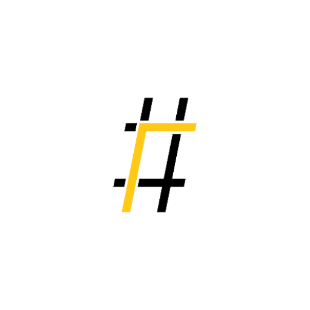
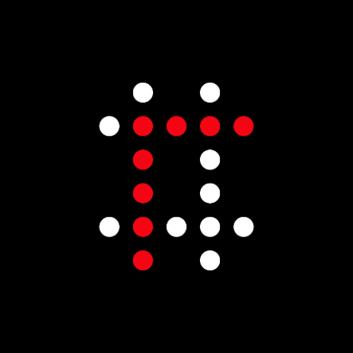

  
  &nbsp;&nbsp;&nbsp;&nbsp;
  

<h1 align="center">realOS</h1>

  <em>Polishing ColorOS into a realOS</em>

  
  
  
  
  
  
  

## INFO
Check [Wiki](https://github.com/Ra1nify/realOS/wiki) For Detail

## License

GPLv3 — see [LICENSE](LICENSE). Documentation is CC BY-SA 4.0.
